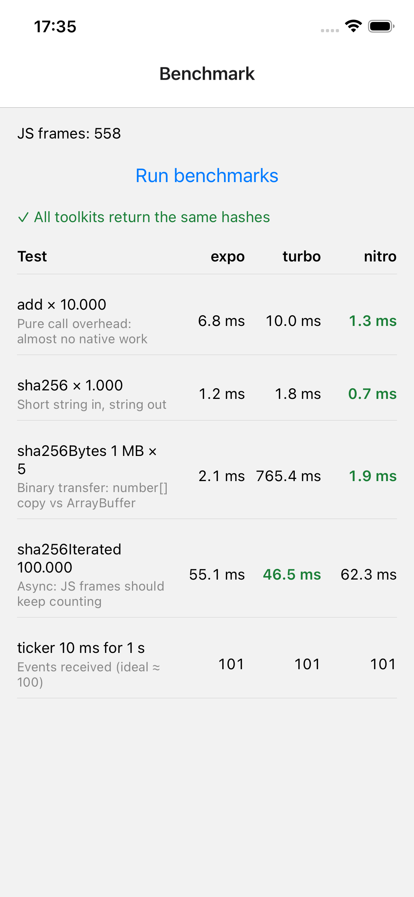
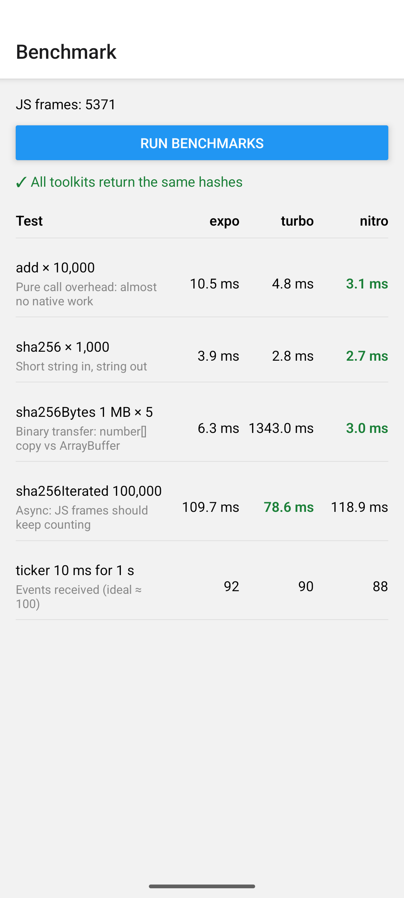

# Native Modules Playground

[English](#english) · [Türkçe](#türkçe)

---

## English

### Why this project exists

React Native has three ways to write a native module today: **Expo Modules**, **Turbo Modules** and **Nitro Modules**. Reading about them only gets you so far, so this project builds **the same module three times**, once with each approach, and puts them side by side in one app.

Every module implements the same small API, `HashToolkit`:

| Method | Why it's there |
|---|---|
| `add(a, b)` | Sync call with almost no native work, so it measures pure call overhead |
| `sha256(text)` | Sync string in, string out |
| `sha256Bytes(data)` | Binary data transfer |
| `sha256Iterated(text, n)` | Async work off the JS thread (Promise) |
| `startTicker` / `stopTicker` + `onTick` | Native to JS events and callbacks |

A benchmark screen then runs the same workload against all three.

### Project structure

```
modules/
  expo-hash-toolkit/    Expo Modules API (Swift + Kotlin DSL)
  turbo-hash-toolkit/   Turbo Module (TS spec → codegen, ObjC++ + Kotlin)
  nitro-hash-toolkit/   Nitro Module (TS spec → nitrogen, Swift + Kotlin)
src/
  toolkits/             Adapters that put all three behind one HashToolkit interface
  benchmark/cases.ts    Benchmark cases
  app/index.tsx         Benchmark screen
plugins/
  withSceneLifecycle.js Config plugin for the iOS UIScene life cycle
```

### The three approaches at a glance

| | Expo Modules | Turbo Modules | Nitro Modules |
|---|---|---|---|
| Source of truth | Swift/Kotlin DSL | TypeScript spec | TypeScript spec |
| Code generation | None | Codegen (runs on `pod install` / Gradle build) | `nitrogen` (run by hand, output committed) |
| iOS language | Swift | Objective-C++ | Swift |
| Binary data | `Uint8Array` | `number[]` (every byte is copied) | `ArrayBuffer` (no copy) |
| Events | `sendEvent` + `addListener` | `EventEmitter` + `emitOnTick` | Plain callback parameter |
| Instances | Singleton | Singleton | `createHybridObject`, as many as you want |
| Linking | `expo-module.config.json` in `modules/` | `package.json` dependency | `package.json` dependency |

### What we learned

**Expo Modules**
- The least ceremony: no spec file, no codegen. The Swift/Kotlin `ModuleDefinition` DSL is the API.
- Local modules in `modules/` are autolinked through `expo-module.config.json`, with no `package.json` dependency needed.
- `Uint8Array`, Promises and events (`Events` + `sendEvent`) are supported out of the box.

**Turbo Modules**
- The **TS spec is the source of truth**. Codegen turns it into an ObjC protocol (`NativeTurboHashToolkitSpec`) and an abstract Kotlin/Java class.
- Codegen produces **interfaces only**. It never writes method stubs into your files, so you write the matching signatures yourself, and the compiler tells you when they don't match.
- Codegen runs during `pod install` (iOS) and the Gradle build (Android), so with CNG `npx expo prebuild --clean` triggers it too.
- Codegen doesn't support `Uint8Array`/`ArrayBuffer`, so bytes travel as `ReadonlyArray<number>` and get copied one by one.
- `CodegenTypes.EventEmitter<T>` (RN 0.76+) replaces `NativeEventEmitter`. Using it makes the generated iOS class extend `NativeTurboHashToolkitSpecBase`, which provides `emitOnTick`.
- Threading: sync methods run on the JS thread. On iOS, void/Promise methods run on the module's method queue, and on Android on the native modules thread.

**Nitro Modules**
- `nitrogen` generates C++, Swift and Kotlin specs from one TS file. The generated code is committed, so you only rerun it when the spec changes.
- A Hybrid Object is **not a singleton**: each `createHybridObject` call creates a new instance with its own state. That's why it's created once and exported.
- `ArrayBuffer` crosses the bridge without copying, and callbacks are ordinary function parameters, so no event emitter is needed.
- `Promise.parallel { }` runs async work on a background thread.
- Pitfall: the template's `package.json` points `types` at `lib/index.d.ts`, which doesn't exist until you build. Pointing `main` at `src/index` fixes the "Cannot find module" error.

**Expo / project setup**
- With **Continuous Native Generation**, `ios/` and `android/` are generated and gitignored. Native changes go through `app.json` and config plugins, never by hand.
- iOS 27 requires the **UIScene life cycle**. `plugins/withSceneLifecycle.js` plus `UIApplicationSceneManifest` in `app.json` hand window creation to Expo's `EXExpoAppSceneDelegate`.
- Module build outputs (`android/build`, `.cxx`, `.gradle`) need to be gitignored, or a single build adds hundreds of changes.
- A `@/modules/*` path alias in `tsconfig.json` lets the app import local modules cleanly.

### Benchmark

The screen at `src/app/index.tsx` runs these cases against every toolkit and highlights the fastest:

| Case | What it measures |
|---|---|
| `add` × 10,000 | Call overhead |
| `sha256` × 1,000 | Short string round trip |
| `sha256Bytes` 1 MB × 5 | Binary transfer (`number[]` copy vs `ArrayBuffer`) |
| `sha256Iterated` 100,000 | Async path. The JS frame counter should keep running |
| ticker 10 ms for 1 s | Events received (ideal ≈ 100) |

It also checks that all three return the same hashes.

#### Results

Release builds on an Apple Silicon Mac: **iPhone 16e simulator (iOS 26)** and **Android emulator (Android 16, arm64)**. Absolute numbers will differ on real devices, and runs vary by about ±20%, so look at the ratios.

<p>
  
  
</p>

| Case | Expo (iOS · Android) | Turbo (iOS · Android) | Nitro (iOS · Android) |
|---|---|---|---|
| `add` × 10,000 | 6.8 · 10.5 ms | 10.0 · 4.8 ms | **1.3 · 3.1 ms** |
| `sha256` × 1,000 | 1.2 · 3.9 ms | 1.8 · 2.8 ms | **0.7 · 2.7 ms** |
| `sha256Bytes` 1 MB × 5 | 2.1 · 6.3 ms | 765 · 1343 ms | **1.9 · 3.0 ms** |
| `sha256Iterated` 100,000 | 55 · 110 ms | **47 · 79 ms** | 62 · 119 ms |
| ticker (events) | 101 · 92 | 101 · 90 | 101 · 88 |

**What the numbers say**

- **Call overhead:** Nitro is the fastest on both platforms. Turbo depends on the platform: on iOS it's the slowest, because ObjC Turbo modules dispatch every call through `NSInvocation`, while on Android (JNI) it's close to Nitro. Expo pays for its argument conversion layer.
- **Binary data:** Turbo is **~350× (iOS) and ~450× (Android) slower**, because codegen has no `ArrayBuffer`, so every byte becomes a boxed number. Don't move binary data through a codegen array.
- **Work that stays native:** `sha256Iterated` crosses the bridge only once, so all three are close. The small gaps come from the crypto library (CommonCrypto vs CryptoKit) and thread scheduling, not from the bridge.
- **Ticker on Android (~90):** the Kotlin implementations reschedule with `Handler.postDelayed` after each tick, so the delay drifts. That's the timer implementation, not the bridge.

**Lesson: a benchmark measures your code as well as the bridge.** The first iOS run said "Turbo hashes 4× faster". The real cause was the hex conversion: Swift's `map { String(format: "%02x") }` against ObjC's `appendFormat`. Switching all modules to the same lookup table took `sha256Iterated` from **~2000 ms to ~55 ms**, and the gap disappeared.

### Running it

This app needs a **development build**. Expo Go doesn't include custom native code.

```bash
npm install
npx expo run:ios       # or: npx expo run:android
npx expo run:ios --configuration Release   # for benchmark numbers
```

Changing a spec:

```bash
# Turbo: codegen runs as part of the native build
npx expo prebuild --clean

# Nitro: regenerate specs, then rebuild
cd modules/nitro-hash-toolkit && npx nitrogen@0.37.1   # keep in sync with react-native-nitro-modules
```

**Stack:** Expo SDK 57 · React Native 0.86 · Expo Router · react-native-nitro-modules 0.37

---

## Türkçe

### Bu proje neden var

React Native'de bugün native modül yazmanın üç yolu var: **Expo Modules**, **Turbo Modules** ve **Nitro Modules**. Sadece okuyarak bir yere kadar anlaşılıyor. Bu yüzden bu projede **aynı modül üç kez**, her yaklaşımla bir kez yazıldı ve hepsi tek bir uygulamada yan yana kondu.

Her modül aynı küçük API'yi, yani `HashToolkit`'i implemente ediyor:

| Metot | Neden var |
|---|---|
| `add(a, b)` | Native tarafta neredeyse hiç iş yok, yani saf çağrı maliyetini ölçüyor |
| `sha256(text)` | Senkron, string girip string çıkıyor |
| `sha256Bytes(data)` | Binary veri aktarımı |
| `sha256Iterated(text, n)` | JS thread dışında async iş (Promise) |
| `startTicker` / `stopTicker` + `onTick` | Native'den JS'e event ve callback |

Ardından bir benchmark ekranı aynı iş yükünü üçünde de çalıştırıyor.

### Proje yapısı

```
modules/
  expo-hash-toolkit/    Expo Modules API (Swift + Kotlin DSL)
  turbo-hash-toolkit/   Turbo Module (TS spec → codegen, ObjC++ + Kotlin)
  nitro-hash-toolkit/   Nitro Module (TS spec → nitrogen, Swift + Kotlin)
src/
  toolkits/             Üçünü tek bir HashToolkit arayüzünün arkasına koyan adapter'lar
  benchmark/cases.ts    Benchmark senaryoları
  app/index.tsx         Benchmark ekranı
plugins/
  withSceneLifecycle.js iOS UIScene life cycle için config plugin
```

### Üç yaklaşım bir bakışta

| | Expo Modules | Turbo Modules | Nitro Modules |
|---|---|---|---|
| Doğruluk kaynağı | Swift/Kotlin DSL | TypeScript spec | TypeScript spec |
| Kod üretimi | Yok | Codegen (`pod install` / Gradle build sırasında) | `nitrogen` (elle çalıştırılıyor, çıktısı commit'leniyor) |
| iOS dili | Swift | Objective-C++ | Swift |
| Binary veri | `Uint8Array` | `number[]` (her byte kopyalanıyor) | `ArrayBuffer` (kopyasız) |
| Event | `sendEvent` + `addListener` | `EventEmitter` + `emitOnTick` | Düz callback parametresi |
| Instance | Singleton | Singleton | `createHybridObject`, istediğin kadar |
| Link'leme | `modules/` içinde `expo-module.config.json` | `package.json` dependency | `package.json` dependency |

### Neler öğrendik

**Expo Modules**
- En az tören gerektiren yol: spec dosyası yok, codegen yok. API'nin kendisi Swift/Kotlin `ModuleDefinition` DSL'i.
- `modules/` altındaki yerel modüller `expo-module.config.json` üzerinden otomatik link'leniyor, `package.json`'a eklemek gerekmiyor.
- `Uint8Array`, Promise ve event'ler (`Events` + `sendEvent`) kutudan çıktığı gibi destekleniyor.

**Turbo Modules**
- **TS spec doğruluk kaynağı.** Codegen ondan bir ObjC protocol'ü (`NativeTurboHashToolkitSpec`) ve abstract bir Kotlin/Java sınıfı üretiyor.
- Codegen **sadece arayüz** üretiyor. Senin dosyalarına metot iskeleti yazmıyor. Eşleşen imzaları sen yazıyorsun, uyuşmazlarsa derleyici söylüyor.
- Codegen `pod install` (iOS) ve Gradle build (Android) sırasında çalışıyor. CNG ile `npx expo prebuild --clean` de onu tetikliyor.
- Codegen `Uint8Array`/`ArrayBuffer` desteklemiyor. Byte'lar `ReadonlyArray<number>` olarak gidiyor ve tek tek kopyalanıyor.
- `CodegenTypes.EventEmitter<T>` (RN 0.76+) `NativeEventEmitter`'ın yerini alıyor. Bunu kullanınca üretilen iOS sınıfı `NativeTurboHashToolkitSpecBase`'den türüyor ve `emitOnTick` oradan geliyor.
- Thread'ler: senkron metotlar JS thread'inde çalışıyor. void/Promise metotlar iOS'ta modülün method queue'sunda, Android'de native modules thread'inde çalışıyor.

**Nitro Modules**
- `nitrogen` tek bir TS dosyasından C++, Swift ve Kotlin spec'leri üretiyor. Üretilen kod commit'leniyor, sadece spec değişince yeniden çalıştırılıyor.
- Hybrid Object **singleton değil**: her `createHybridObject` çağrısı kendi state'i olan yeni bir instance oluşturuyor. Bu yüzden bir kez oluşturulup export ediliyor.
- `ArrayBuffer` kopyalanmadan geçiyor. Callback'ler normal fonksiyon parametresi, event emitter'a gerek yok.
- `Promise.parallel { }` async işi arka plandaki bir thread'de çalıştırıyor.
- Tuzak: template'teki `package.json`, `types` alanını build edilene kadar var olmayan `lib/index.d.ts`'e yönlendiriyor. `main`'i `src/index`'e çevirmek "Cannot find module" hatasını çözüyor.

**Expo / proje kurulumu**
- **Continuous Native Generation** ile `ios/` ve `android/` üretiliyor ve gitignore'da duruyor. Native değişiklikler elle değil, `app.json` ve config plugin'lerle yapılıyor.
- iOS 27 **UIScene life cycle** zorunlu kılıyor. `plugins/withSceneLifecycle.js` ve `app.json`'daki `UIApplicationSceneManifest`, pencere oluşturmayı Expo'nun `EXExpoAppSceneDelegate`'ine bırakıyor.
- Modüllerin build çıktıları (`android/build`, `.cxx`, `.gradle`) gitignore'a eklenmeli, yoksa tek bir build yüzlerce değişiklik ekliyor.
- `tsconfig.json`'daki `@/modules/*` alias'ı, uygulamanın yerel modülleri temiz şekilde import etmesini sağlıyor.

### Benchmark

`src/app/index.tsx`'teki ekran bu senaryoları her toolkit'e karşı çalıştırıyor ve en hızlıyı vurguluyor:

| Senaryo | Neyi ölçüyor |
|---|---|
| `add` × 10.000 | Çağrı maliyeti |
| `sha256` × 1.000 | Kısa string gidiş-dönüş |
| `sha256Bytes` 1 MB × 5 | Binary aktarım (`number[]` kopyası vs `ArrayBuffer`) |
| `sha256Iterated` 100.000 | Async yol. JS frame sayacı durmamalı |
| ticker 10 ms, 1 sn | Alınan event sayısı (ideal ≈ 100) |

Ayrıca üçünün de aynı hash'leri döndürdüğünü kontrol ediyor.

#### Sonuçlar

Apple Silicon Mac üzerinde Release build'ler: **iPhone 16e simülatörü (iOS 26)** ve **Android emülatörü (Android 16, arm64)**. Gerçek cihazlarda mutlak sayılar farklı olur ve ölçümler arasında yaklaşık ±%20 oynama var. Oranlara bak.

<p>
  
  
</p>

| Senaryo | Expo (iOS · Android) | Turbo (iOS · Android) | Nitro (iOS · Android) |
|---|---|---|---|
| `add` × 10.000 | 6,8 · 10,5 ms | 10,0 · 4,8 ms | **1,3 · 3,1 ms** |
| `sha256` × 1.000 | 1,2 · 3,9 ms | 1,8 · 2,8 ms | **0,7 · 2,7 ms** |
| `sha256Bytes` 1 MB × 5 | 2,1 · 6,3 ms | 765 · 1343 ms | **1,9 · 3,0 ms** |
| `sha256Iterated` 100.000 | 55 · 110 ms | **47 · 79 ms** | 62 · 119 ms |
| ticker (event) | 101 · 92 | 101 · 90 | 101 · 88 |

**Sayılar ne diyor**

- **Çağrı maliyeti:** Nitro iki platformda da en hızlısı. Turbo platforma göre değişiyor: iOS'ta en yavaşı, çünkü ObjC Turbo modülleri her çağrıyı `NSInvocation` üzerinden gönderiyor. Android'de (JNI) ise Nitro'ya yakın. Expo, argüman dönüştürme katmanının bedelini ödüyor.
- **Binary veri:** Turbo **~350× (iOS) ve ~450× (Android) daha yavaş**, çünkü codegen'de `ArrayBuffer` yok ve her byte kutulanmış bir sayıya dönüşüyor. Binary veriyi codegen dizisiyle taşıma.
- **Native'de kalan iş:** `sha256Iterated` köprüyü sadece bir kez geçiyor, o yüzden üçü de birbirine yakın. Küçük farklar köprüden değil, kripto kütüphanesinden (CommonCrypto vs CryptoKit) ve thread zamanlamasından geliyor.
- **Android'de ticker (~90):** Kotlin implementasyonları her tick'ten sonra `Handler.postDelayed` ile yeniden zamanlıyor, bu yüzden gecikme kayıyor. Bu köprüden değil, timer implementasyonundan kaynaklanıyor.

**Ders: bir benchmark köprüyle birlikte senin kodunu da ölçer.** İlk iOS ölçümü "Turbo 4× daha hızlı hash'liyor" diyordu. Asıl sebep hex dönüşümüydü: Swift'teki `map { String(format: "%02x") }` ile ObjC'deki `appendFormat`. Tüm modülleri aynı lookup table'a geçirmek `sha256Iterated`'ı **~2000 ms'den ~55 ms'ye** indirdi ve fark ortadan kalktı.

### Çalıştırma

Bu uygulama bir **development build** gerektiriyor. Expo Go özel native kod içermiyor.

```bash
npm install
npx expo run:ios       # veya: npx expo run:android
npx expo run:ios --configuration Release   # benchmark sayıları için
```

Spec değiştirince:

```bash
# Turbo: codegen native build'in bir parçası olarak çalışıyor
npx expo prebuild --clean

# Nitro: spec'leri yeniden üret, sonra yeniden build al
cd modules/nitro-hash-toolkit && npx nitrogen@0.37.1   # keep in sync with react-native-nitro-modules
```

**Stack:** Expo SDK 57 · React Native 0.86 · Expo Router · react-native-nitro-modules 0.37
